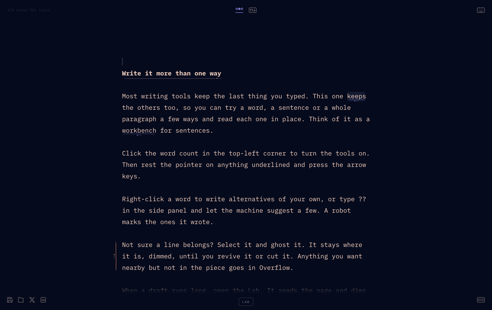

# Write_On for macOS, an unofficial replica

A replica, as a Mac app, of the writing tool Jason Fried showed in
[this thread](https://x.com/jasonfried/status/2105403067793584590). It keeps the other
ways you tried to say something: alternatives for a word, a sentence or a whole paragraph
stay in place, under the text, and you flip through them where they stand. Around that:
ghosted text, an Overflow panel, AI suggestions, a Lab that marks and trims without
rewriting, and one plain Markdown file that holds all of it.



**This is not his Write_On.** The idea, the design and the name are Jason Fried's. He had
no part in this project and has not endorsed it. No code, recording or picture of his is
in this repository, and the essay he writes in the clips is not here either. What it takes
from him is what the three clips in the thread show: how the tool looks, moves, sounds
and saves, and the wording of its labels. In the first clip he says he hopes to release
his own, free and open source. When he does, that is the one to use.

The look, motion, sound and file format were measured from those clips. What the clips do
not show had to be decided; those decisions are listed
[below](#decisions-the-clips-do-not-settle).

- Design: `docs/superpowers/specs/2026-10-11-write-on-replica-design.md`
- Plan it was built from: `docs/superpowers/plans/2026-10-11-write-on-replica.md`
- How it is built, with diagrams: `docs/architecture.html` (open it in a browser)

The app was written by Claude, in Claude Code, working from that design and that plan.

## Build and run

There is nothing to download: you build it.

- macOS 13 or later is what the app is built for. It has been built and run on macOS 26
  only.
- The Xcode Command Line Tools (`xcode-select --install`), with Swift 5.9 or later (it
  has been built with 6.3 only). Xcode itself is not needed.
- For the tests only: Node. They have been run with Node 26; 22 or later should do, since
  the test command leaves its `*.test.js` pattern to Node. Nothing is installed from npm.

```sh
scripts/build-app.sh        # builds build/Write_On.app
open build/Write_On.app     # or double-click it in Finder; drag it to Applications to keep it
```

The first window shows a short welcome piece. The app opens as a bare editor, text and a
word count: **click the word count** (top left) to turn the tools on, and again to turn them
off. Every window after the first starts blank; Help ▸ The Welcome Piece brings it back.

## Using it

| Shortcut | What it does |
| --- | --- |
| Ctrl+Shift+R, or click the word count | Read mode: just the text |
| Ctrl+Shift+A | Alternatives for the selection, or the word at the caret; with the caret on no word, the word under the pointer |
| Ctrl+Shift+G | AI alternatives, for the same |
| Ctrl+/ | Ghost it, or revive it |
| Ctrl+Shift+X | Stash the selection (or the paragraph) in Overflow |
| Ctrl+Shift+D | Overflow panel |
| Ctrl+Return, in Overflow | Use the selection in the page |
| Ctrl+U | The file as saved |
| Ctrl+S, Ctrl+O | Save, Open |
| Ctrl+Shift+P | Post to X |
| ⌘N, ⌘O, ⌘S, ⇧⌘S, ⌘W, ⌘Z, ⇧⌘Z, ⌘, | New, Open, Save, Save As, Close, Undo, Redo, Settings |

As in the original, the app's own shortcuts use Control, on the Mac too. Everything is also
in the menu bar, and a right-click on the text gives Alternatives, AI alternatives, Ghost
and Stash.

- **Under the pointer.** Rest the pointer on anything underlined and press the arrow keys to
  flip through its versions; Delete removes the one showing (and blows it up). Each change
  ticks, and the tick is lower when you land back on the version you started from.
- **The panel.** Alternatives opens a panel on the left with a row for each version. Type a
  new one in the empty row; type `??` there to have the AI suggest some. A robot marks the
  ones it wrote. ([Picture](docs/images/panel.png).)
- **The Lab** (bottom centre) reads the page and marks what it finds: weak or long
  sentences, filler, typos, or what could go to make the piece 10, 20, 30 or 50 percent
  shorter. It fades and underlines; it never rewrites. Nothing is cut until you say so.
- **Edit ▸ Spelling and Grammar, Substitutions.** Spell checking, autocorrection and smart
  quotes are all off until you turn them on there, whatever the system's settings say.

### The file

One Markdown file. Any other tool sees ordinary Markdown, as the piece currently reads.
Overflow follows a `<!-- overflow -->` line, and the alternatives, with which one is
showing and what is ghosted, are in a `<!-- write_on {…} -->` comment at the end. A piece
with no alternatives and nothing ghosted is saved as plain Markdown with no comment at all.
A file edited elsewhere opens with its text as it now is, and keeps the alternatives whose
words are still there.

The format follows what the third clip shows of the original's, down to the `write_on`
comment. That is 52 seconds of one file: whether his tool would open a file saved here,
or this one a file of his, has never been tried.

Saving replaces the file's text and nothing else (its permissions and Finder tags stay,
and a link stays a link). If something else has changed the file since the window read or
wrote it, saving asks before writing over it.

Unsaved work is copied to `~/Library/Application Support/Write_On/Drafts` every few seconds
and comes back as an unsaved document if the app is ever killed.

### The AI

AI alternatives and the Lab ask a language model. Everything else works without one.

The app speaks OpenAI-style chat completions (`POST <address>/chat/completions`, with the
answer streamed). Out of the box it asks LunaRoute (`https://gw.lunaroute.com/v1`) for
`glm-5.3-flash`, and that is the only service and the only model it has been tried with.
Settings (⌘,) takes another address, which may be a model served on this Mac, and
another model, and has a Test connection button that says which key it used.
`LUNAROUTE_BASE_URL` in the environment sets the address too. Another service has to
take what every request carries: `max_tokens`, `reasoning_effort` and, from the Lab, an
answer held to a JSON schema (`response_format`).

A key is always sent, so a server that wants none still needs something typed in the
field. The app looks for the key in this order:

1. a key saved in Settings, which goes in your keychain;
2. `LUNAROUTE_API_KEY` in the app's own environment;
3. `LUNAROUTE_API_KEY` as your login shell sets it (so a key in `~/.zshrc` is found when the
   app is opened from Finder). For this the app runs your login shell once, as a terminal
   would start it, the first time it has to look further than Settings and its own
   environment, and reads `LUNAROUTE_API_KEY` and `LUNAROUTE_BASE_URL` from it.

The key never reaches the editor's page: the native side of the app makes the request and
hands back text.

**What leaves your Mac.** Nothing, until you ask the AI for something. A request for
alternatives carries the paragraph the word is in and the versions you already have. The
Lab sends the page's paragraphs, without the headings and without what is ghosted. A trim
sends them once for the level you chose and then, for as long as it is on the page, once
for each of the other three, so that they are there when you go to them; Done stops
that. All of it goes to the address above and nowhere else, and Overflow is never sent.
There is no telemetry and nothing checks for updates. The only other thing that goes
anywhere is Post to X, which opens X's compose page in your browser with the piece in the
link.

Alternatives come back in a second or two. **A trim is slow with this model:** 9 to 22
seconds for the 170-word welcome piece and 16 to 50 seconds for a 570-word one, where the
original takes a second or two. The model reasons its way to the word count; a quicker way
of asking took 5 seconds and cut a third of what was asked for, so accuracy was kept. The
measurements are in the spec, §7.1.

## What a person has to check

Everything else is tested by script with nothing on screen (see [Working on it](#working-on-it)).
These need someone at the Mac:

1. **It opens.** Double-click `build/Write_On.app`: one window, the welcome piece, the app
   in front. Click the Dock icon with no window open: one new blank window.
2. **Real hover.** With the tools on, the icons light and show their shortcuts under the
   pointer. Rest the pointer on an underlined word and press the arrow keys: the word flips
   through its versions, with the ticks. Click the word first and they still do.
3. **The pointer and typing.** Type with the pointer resting on an underlined word: its
   tint goes and the arrow keys move the caret, not the word. Move the pointer and the
   tint is back and they flip it again.
4. **Shortcuts once.** Ctrl+Shift+R turns the tools off, and again on: once per press, not
   twice. (Each Control shortcut is also a menu item; the page is meant to get the key
   first.) The same for Ctrl+Shift+D and Ctrl+U.
5. **Drag from Overflow.** Open Overflow, select some of its text and drag it into the page.
6. **The LinkedIn button.** Chase it with the pointer. It should bolt six times and blow up
   on the seventh approach.
7. **How it sounds.** The two ticks, the boom, and the sound of undoing a delete. Settings ▸
   Play sounds turns them off in every window.
8. **Panels.** ⌘S on a new document drops a save panel from the window, offering the
   heading as the name. ⌘O, Open Recent. Close with unsaved changes: Save, Cancel, Don't Save.
   Quit with two unsaved windows: asked about each in turn. Change an open file in another
   editor and then save it here: asked before it is written over.
9. **From Finder.** Right-click a `.md` file ▸ Open With ▸ Write_On.
10. **After a crash.** Type something, wait five seconds, `killall -9 WriteOn`, open the app
    again: the work is back, unsaved, with a note by the Save icon.
11. **Settings.** Paste a key: the line under the field says "Using the key saved here."
    Test connection answers in about a second. (After rebuilding the app, macOS may ask
    once for permission to read the saved key, because a locally built app is signed anew
    each time.)
12. **Edit menu.** Check Spelling While Typing puts the red marks under a misspelt word, and
    Smart Quotes curls the quotes; both are off to begin with.
13. **Full screen** (the green button, or fn F): the layout then matches the clips exactly,
    with no title bar above the page.
14. **Post to X** (the X icon): the browser opens X's compose window with the piece in it.
15. **About.** Write_On ▸ About Write_On: under the version, a line saying that this is an
    unofficial replica.

## Decisions the clips do not settle

The full list, 52 items with the reasoning, is §9 of the spec. In short:

**Alternatives.** Groups do not nest: making a larger group over smaller ones turns the
smaller ones back into text (undo restores them). A selection's scope follows what it
covers: a whole paragraph of several sentences is a paragraph group, one or more whole
sentences a sentence group, anything else a word group. Under the pointer → and ↓ go
forward, ← and ↑ back, and they wrap. The arrows are the underlined text's while the
pointer is what you last used: it has moved, clicked or scrolled since you last typed.
The text is tinted while that is so. Typing gives the arrows back to the caret until the
pointer moves again. Which version shows is not a step to undo. Five AI suggestions
for a word, three for a sentence or paragraph. In the panel, ↑ and ↓ do not wrap, an
emptied row removes its version, and the last version cannot be removed.

**Ghost, Overflow, the Lab.** Ghost with no selection takes the word at the caret. Stash
with no selection takes the paragraph, and stashed text goes to the end of Overflow.
Ctrl+Return moves text out of Overflow rather than copying it. "Walk through" steps through
a trim one cut at a time (Cut, Keep, Stop). The marking passes underline in the Lab's
crimson and give their reason on hover; a click dismisses a mark. The typo pass shows each
fix on hover and has Fix all. The Lab guide and the keyboard icon open cards.

**Files and the Mac.** Everything about being a Mac app: the blended title bar, the menu
bar, Save As, Open Recent, the unsaved-changes question, drafts against a crash, several
windows, the file's name coming from its first heading, the Settings window. The Save icon
being lit means unsaved changes, and saving is always explicit. A file opens in the window
that already has it, else in one nobody has written in, else in its own.

**Sharing.** Post to X opens X's compose window with the piece as it reads (no heading
mark, nothing ghosted, nothing from Overflow) and does not use X's API; a piece too long
for a link goes to the clipboard instead, with a note. The LinkedIn button's numbers are
measured from the clip.

**Typing.** `# ` at the start of a line makes a heading and hides the mark. Spell checking,
autocorrection and smart punctuation are off by default.

### Known differences from the original

- Lines are 36 px apart, not 36.4, and Overflow's 22, not 22.5: WebKit sets lines of text a
  whole number of pixels apart, and the original runs in a browser that does not.
- A selection that runs past the end of a line is drawn a little differently by WebKit.
- The Lab's trims take much longer (see [The AI](#the-ai)): about twenty seconds for a
  short piece against two in the clip. Nearly all of that is the model thinking before it
  answers, so the cuts, which are faded as they arrive, come in the last second of it.
  Once a level has been read the others are read quietly, one at a time, for as long as
  the trim is on the page, and going to one that has been read is immediate, as it is in
  the clip. Each is a request to the service.
- Two things the original does when it scrolls are not copied, because they look like
  slips: closing the panel jumps the page to the top, and the wheel scrolls the page
  behind the source view once the view reaches its end.
- The proposal card's width for "Even sharper" and "Cut in half" is extrapolated; the clips
  show only the first two levels.

## Working on it

```sh
npm test                     # unit tests for the document logic (Node's own runner, no packages)
scripts/build-app.sh         # build build/Write_On.app with SwiftPM
scripts/check.sh             # everything: unit tests, a build, every UI scenario
scripts/ui-test.sh files     # one scenario from tests/ui, in the app's own web view
scripts/ui-test.sh smoke --zoom 2
scripts/launch-check.sh      # start the real app once, hidden, and see that it comes up
scripts/bench.sh typing      # one measurement from tests/perf, out of sight (see Speed)
scripts/dev-server.sh        # serve the page at http://127.0.0.1:4173 for work in a browser
scripts/screenshots.sh       # take the pictures in docs/images again, out of sight
swift scripts/make-icon.swift  # draw packaging/AppIcon.icns again
```

The scripts that run scenarios use `python3` to print their results; it comes with the
Command Line Tools.

The app is two parts. `Sources/WriteOn` is a small AppKit shell: windows, the menu bar,
files, the key, the network. `web/` is the editor, a page of plain ES modules with no build
step and no third-party code, shown in a `WKWebView`: `src/doc` and `src/ai` are pure
functions (the document model, the file format, prompts and the checking of answers) and
are what `npm test` covers; `src/editor`, `src/features` and `src/fx` sit on top. The two
talk over a small request-and-reply bridge.

### UI scenarios

`scripts/ui-test.sh <name>` launches the built app with `--ui-test`, runs
`tests/ui/<name>.js` inside the page and writes snapshots and `result.json` to
`build/ui/<name>/`. The page is read from `web/` in the working copy, so page-only changes
need no rebuild. `--zoom 2` makes the page lay out and paint as it does on a 2x display,
whatever display the Mac has, which is the scale of the source clips. A scenario can ask
for launch options of its own on its first line (`// launch: --setting read=false`).

A scenario is the body of an async function with a helper `t` in scope
(`tests/ui/_harness.js`): assertions, snapshots and input. Clicks, drags, typing and
shortcuts are native events handed straight to the app's web view.

**Scripted runs are headless.** A run is a background process with no Dock icon that is
never the active app. Its window is parked far outside every display, and is transparent,
click-through and unable to take the keyboard. Nothing you type or click reaches it and it
takes nothing from you. It also leaves the rest of the Mac as it found it:

- save and open panels and alerts are never shown: the scenario says how each is to be
  answered, and files go in the run's own folder;
- the menu bar is read and chosen from without being shown;
- the clipboard, the keychain, the list of recent documents and the speakers are left
  alone (a run has its own of each, in memory);
- the browser is never opened: the run notes what it was asked to open;
- nothing is written to the app's saved settings, and a run that changes them fails;
- it cannot reach the real AI service. Most scenarios get a scripted provider; the client
  itself is tested over HTTP against a stand-in gateway on this Mac
  (`tests/ui/support/fake-gateway.mjs`), with a key the stand-in knows.

`tests/ui/smoke.js` checks the first part on every run, and the harness fails any run that
came to the front, took the keyboard or changed the saved settings. Inside, the harness
makes WebKit treat the page as visible and focused, so scenarios run the same whether the
Mac is in use, locked or unattended. They do need a window server session (someone logged
in at the console, even if locked), because WebKit will not lay out a page without one.
Pointer moves and turns of the wheel are native events too, sent the way WebKit's own
test runner sends them, so WebKit itself finds what is under the pointer and repeats the
pointer's place when the page scrolls beneath it, as it does for a person.

The harness is compiled into the app and does nothing unless the app is started with
`--ui-test`. To move the pointer, set the display's scale and wait for a frame, a scripted
run calls methods of `WKWebView` that Apple does not publish: `_simulateMouseMove:` and a
few like it in `UITestHarness.swift`, and one in `DocumentWindowController.swift`. They
are the ones WebKit's own tests use, and they may change with any release of macOS.
Outside scripted runs the app uses one unpublished setting of the web view,
`drawsBackground`. An app with these in it cannot go on the App Store as it stands.

`WRITEON_APP=build/dev/Write_On.app` in front of `scripts/build-app.sh`, `check.sh`,
`ui-test.sh` or `bench.sh` builds and tests a second copy, so the one in `build/` can stay
open while you work.

One scenario does ask the real service, and steps aside unless told to run:

```sh
scripts/ui-test.sh ai-live --ai live   # five words, three sentences and a trim, with your key
```

It asks LunaRoute for `glm-5.3-flash`, and expects your login shell to set
`LUNAROUTE_API_KEY` (a scripted run does not read the keychain). Without both it fails.

Two things in the app are there for working on it and are on in every copy. Safari's Web
Inspector can attach to the page (Develop menu), and `WRITEON_WEB_ROOT` in the app's
environment makes it read the page from that folder and not from its own bundle, which is
how the scripts above run a built app against the working copy.

### Speed

`scripts/bench.sh <name>` runs a measurement from `tests/perf` the way a scenario is run,
with nothing on screen, and prints what it found:

| | |
| --- | --- |
| `typing` | From a key being sent to the frame that shows the letter, in pieces of up to 50,000 words |
| `interact` | The same for the tint under the pointer, flipping a word, moving the caret, Return; and whether every frame of the panel sliding and of the page scrolling is drawn |
| `launch` | How long opening takes, the memory the app and WebKit's processes hold, and what five idle seconds cost |
| `wasm` | The same word count three ways: as the app does it, as a plain loop, and in WebAssembly |

`node tests/perf/doc.bench.mjs` times the document's own functions away from any browser,
and `swift -O tests/perf/native-baseline.swift` does the typing measurement in AppKit's own
text view, as a yardstick. On a Mac mini (M4 Pro) with a 1x display at 60 Hz:

| Piece | Key to frame, this app | AppKit text view |
| --- | --- | --- |
| The welcome piece | 1.9 ms | 0.9 ms |
| 5,000 words | 2.2 ms | 1.1 ms |
| 50,000 words | 3.3 ms | 1.2 ms |

A display at 60 Hz shows a new frame every 16.7 ms. The app is ready 0.3 s after it is
started. With a caret in the text it and WebKit's processes hold about 210 MB, of which
120 MB is WebKit's graphics process; a page with nothing on it but a caret holds the same.
The document's own work is a few hundredths of a millisecond a keystroke, which is why
WebAssembly has nothing to offer here: in the trial a WebAssembly loop is no faster than
the same loop in JavaScript, and three times slower once the text has been handed to it.

## Credits and what is whose

- **Write_On is Jason Fried's**: the idea, the design, the name and the wording of the
  interface. This project is not connected with him and he has not endorsed it.
- **The fonts** in `web/fonts` are IBM Plex Mono (© IBM Corp.) and Caveat (© The Caveat
  Project Authors), each under the SIL Open Font License 1.1. Their licences sit beside
  them and go into the app with them. `scripts/fetch-fonts.sh` records where the files
  came from and checks them against what was published.
- **The marks on two buttons** are their owners': X's logo, and LinkedIn's redrawn in
  outline, both in `web/index.html`. They are trademarks, used here only to say where a
  button would post.
- **Two well-known algorithms**, both in the public domain, are in
  `web/src/editor/wobble.js`: the FNV-1a hash and the mulberry32 random number generator.
- **The rest was made for this project.** There are no packages and no libraries. The
  sounds are made in code, the icon is drawn by `scripts/make-icon.swift`, and the welcome
  piece was written for it.
- **The clips are not here**, nor frames from them, nor the essay he writes in them. The
  tests do use words the clips show, since they check the same behaviour: the versions
  he tries for one word, and the paperclip that becomes an eraser. Some of their
  sentences are also built the way his opening one is. `reference/`, which git ignores,
  is where the measurements were made.

## Licence

The code and documents here are under the [MIT licence](LICENSE), © 2026 Joey Simhon.
The fonts keep their own. The licence covers what was made for this project: Write_On's
name and design are not this project's to give.
